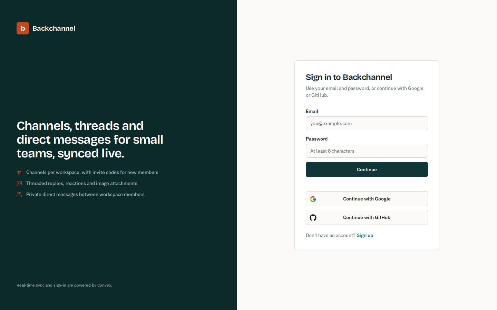
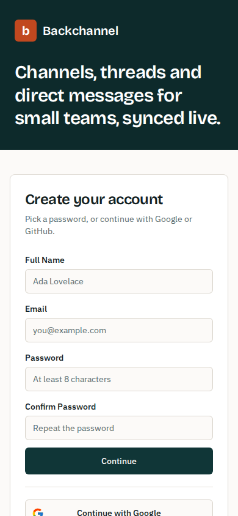
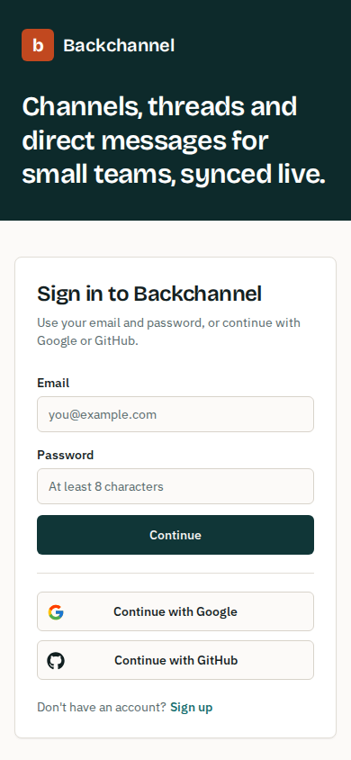
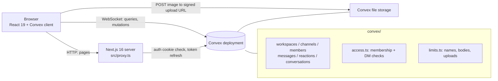

# Backchannel (next14-slack-clone)

A Slack-style team chat built with Next.js and [Convex](https://www.convex.dev). People sign up, create
workspaces, invite others with a six-character join code, and talk in channels, threads and private
direct messages, with emoji reactions and image attachments. Everything updates live through Convex
subscriptions.

**Where it comes from.** This started as a follow-along of Code With Antonio's real-time Slack clone
tutorial (Next.js 14, Convex, Convex Auth, shadcn/ui, Jotai, Quill). The feature set, file layout and
hook names come from that course. Later work on top of it:

- server-side authorization in every Convex function, with offline tests for it
- upload validation, input limits and clean-up of files and reactions on delete
- an upgrade from Next 14 to Next 16 and React 19, plus current Convex Auth
- its own visual identity and accessibility fixes
- a Docker image

The folder name still says "next14", but the app now runs on Next 16.



<p>
  
  
</p>

The screenshots only show the sign-in and sign-up screens. Every other page needs a live Convex
backend, and this project was never connected to one while it was being worked on (see
[Limitations](#limitations)).

## Features

- **Auth:** email and password, plus GitHub and Google OAuth, all through Convex Auth. A Next.js
  proxy (`src/proxy.ts`) sends signed-out visitors to `/auth`.
- **Workspaces:**
  - The creator becomes admin and the workspace gets a `General` channel.
  - Admins can rename the workspace, delete it, and rotate its join code.
  - Others join at `/join/<workspaceId>` with the code.
- **Channels:** admins create, rename and delete them. Names are normalised to slugs such as
  `plan-budget`.
- **Messages:**
  - Rich text (Quill) with one optional image, which must be PNG, JPEG, GIF or WebP and no larger
    than 5 MB.
  - Only the author can edit or delete a message.
  - Messages load 20 at a time, with infinite scroll.
- **Threads and reactions:** you can reply in a thread to any message. Reactions toggle per person,
  and each emoji shows a count.
- **Direct messages:** one conversation per pair of members, which only those two can read.
- **Members:**
  - Admins can promote, demote or remove other members.
  - Anyone can leave.
  - An admin can't demote themselves, so a workspace never ends up without an admin.
- **Search:** the search button in the top bar opens a command palette that jumps to a channel or a
  member.

## How it fits together



Most of the app is client components that subscribe to Convex queries. Next.js mainly serves the shell
and runs the auth proxy. The rules that matter live in `convex/`:

- `access.ts` resolves the caller's membership. A message is readable by members of its workspace,
  except DMs, which only the two participants can read. Every query and mutation goes through it.
- `limits.ts` holds the input rules (names 3-80 characters, message bodies must be a Quill delta of at
  most 20k characters, reactions at most 32 characters) and the upload policy. The editor imports the
  same upload policy, so the browser rejects a bad file before uploading it.
- Uploads go straight from the browser to Convex storage through a short-lived URL. `messages.create`
  then checks the stored file's real metadata, not the type the browser reported.
- Deleting a message, channel, member or workspace also deletes the attached images and reactions.

`convex/_generated/` is committed, as Convex recommends, so the app type-checks and the tests run
without contacting a deployment.

## Running it

You need Node 22 (`.nvmrc`) and a Convex account for the backend. The free tier is enough.

```bash
npm ci
npx convex dev            # log in, create a dev deployment, push convex/; writes .env.local
npx @convex-dev/auth      # one-off: generates JWT keys and sets SITE_URL on the deployment
npm run dev               # http://localhost:3000
```

`npx convex dev` keeps running and re-deploys when files in `convex/` change, so start `npm run dev`
in a second terminal. For GitHub or Google sign-in, set the OAuth credentials on the deployment:

```bash
npx convex env set AUTH_GITHUB_ID <client id>
npx convex env set AUTH_GITHUB_SECRET <client secret>
```

`.env.example` lists every variable and says where each one lives.

### Docker

The image serves the production build as the non-root `node` user. You still need a Convex deployment
with the functions pushed (`npx convex deploy`). Its URL is baked into the client bundle at build time:

```bash
docker build --build-arg NEXT_PUBLIC_CONVEX_URL=https://<your-deployment>.convex.cloud -t backchannel .
docker run --rm -p 3000:3000 backchannel
```

## Tests and checks

```bash
npm test          # Vitest + convex-test: runs the real Convex functions in memory, no network
npm run lint      # ESLint 9 flat config (eslint-config-next)
npm run build
```

The 22 tests are in `convex/*.test.ts`. They run the real Convex functions as different signed-in
users against convex-test's in-memory backend. They cover:

- who can read and write channel, thread and DM messages
- cross-workspace tricks, such as posting into another workspace's channel or opening a DM with an
  outsider
- member removal and role rules
- join codes
- upload type and size checks, and file clean-up on delete
- input limits

There are no browser tests for the chat screens yet.

## Limitations

- The chat screens are desktop-first: a 70px rail plus resizable panels. Only the auth screens are
  laid out for phones.
- A rejected upload stays in Convex storage, because a mutation that throws also rolls back its own
  `storage.delete`. Cleaning these up would need a scheduled job.
- Deleting a thread's parent message keeps the replies in the database, but they are no longer shown.
- `quill` 2.0.3 has an open advisory (GHSA-v3m3-f69x-jf25) in `getSemanticHTML()`, and no fixed
  release exists. This app never calls that function: it renders stored deltas through Quill's own
  blots.
- `convex/_generated` was produced by an older Convex CLI. Two helper modules were added to
  `api.d.ts` by hand. Running `npx convex dev` regenerates the folder.

## License

MIT, see [LICENSE](LICENSE).
